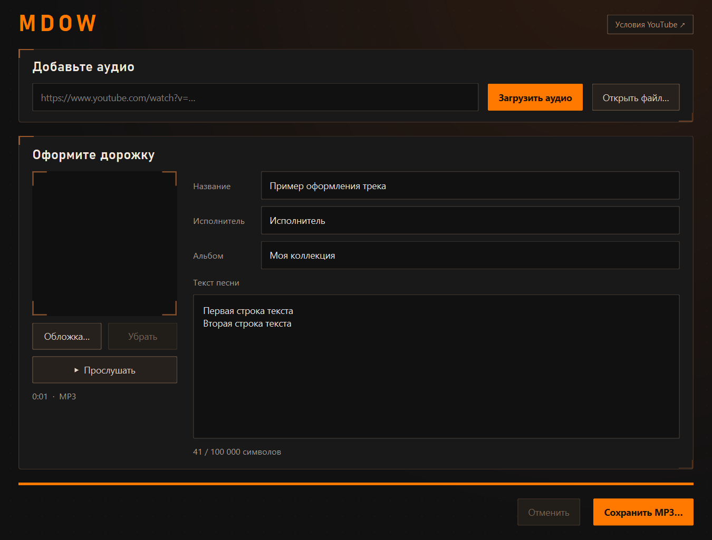

# MDOW

Локальное настольное приложение для Windows: разрешённая загрузка аудио из одного
ролика YouTube или импорт локального файла → MP3 → редактор тегов → сохранение.
Интерфейс на русском, без аккаунтов и сервера.



## Запуск из исходников

Требуется Python 3.12 и [uv](https://docs.astral.sh/uv/getting-started/installation/).
Из корня проекта в PowerShell:

```powershell
uv sync --locked
python tools/setup_tools.py
uv run --locked python -m app
```

Либо после установки зависимостей дважды нажмите `run.cmd`.
Скрипт установки инструментов загружает закреплённые сборки только по явному запуску.
Приложение само ничего не устанавливает и не обновляет.

FFmpeg, ffprobe и Deno можно установить самостоятельно: положите `ffmpeg.exe`,
`ffprobe.exe`, `deno.exe` в `tools/bin/` либо добавьте в `PATH`. FFmpeg должен
содержать `libmp3lame`. Deno нужен только для YouTube; локальный импорт работает без него.
Версии Python-зависимостей закреплены в `pyproject.toml`, транзитивные зависимости — в `uv.lock`.

Локально проверенное окружение: Windows 10 22H2 x64, Python 3.12.16,
PySide6 6.12.0 (Essentials + Addons), yt-dlp 2026.10.26, yt-dlp-ejs 0.8.0,
Mutagen 1.48.1, Pillow 13.0.0, FFmpeg/ffprobe 8.0.1 Gyan Essentials, Deno 2.9.8.
Проверка версии Deno не заменяет ручной тест загрузки YouTube.

## Работа

1. Вставьте HTTPS-ссылку на один ролик и нажмите **Загрузить аудио**.
   Или нажмите **Открыть файл…** для локального аудио. Кнопка условий YouTube
   находится в правом верхнем углу; отдельной галочки подтверждения нет.
2. Название и доступные музыкальные метаданные появятся в редакторе. Изменения,
   внесённые во время загрузки, сохранятся при её завершении. Канал YouTube не
   используется как выдуманный исполнитель или альбом.
3. Отредактируйте название, исполнителя, альбом и текст песни. После подготовки
   аудио можно выбрать или удалить обложку и прослушать результат. Для обложки
   выберите файл или перетащите изображение в область обложки.
   Для вставки из буфера работают **Ctrl+Shift+V**, а при фокусе на области обложки — **Ctrl+V**.
   В открывшемся окне передвиньте квадрат и настройте его размер ползунком или
   перетаскиванием нижнего правого угла. **Применить обложку** обрезает исходное
   изображение, **Отмена** сохраняет прежнюю обложку.
   Для изображения из браузера используйте «Копировать изображение»: одиночная
   веб-ссылка не загружается. Автоматическое скачивание превью YouTube пока не реализовано.
4. Нажмите **Сохранить MP3…**. Пустое поле удаляет соответствующий тег.
   Для замены существующего файла запрашивается подтверждение.

Поддерживаются локальные MP3, WAV, FLAC, M4A, OGG, Opus и другие аудиоформаты FFmpeg.
При импорте MP3 считываются его теги; при импорте других форматов начальное название
берётся из имени файла. Остальные исходные теги не-MP3 пока не переносятся.

MP3 кодируется `libmp3lame -q:a 2` (VBR). Это не улучшает качество источника.
Готовые MP3 при редактировании тегов не перекодируются. Запись — ID3v2.3, UTF-16:
`TIT2`, `TPE1`, `TALB`, `APIC` (front cover), `USLT` (несинхронизированный текст).
Другие совместимые ID3-теги сохраняются. Файл записывается во временную копию
в каталоге назначения, проверяется Mutagen и публикуется атомарно.

**Alt+Enter** — переключение полного экрана с возвратом к прежнему режиму окна.

## Ограничения

- Один ролик за операцию; без плейлистов, текущих трансляций, cookies и авторизации.
- До 2 часов и 500 МиБ исходного аудио; выходной MP3 также ограничен 500 МиБ.
- Обложка: файл до 10 МиБ / 25 мегапикселей на входе; для готового растра в буфере —
  до 25 мегапикселей. Выбранный квадрат сохраняется как JPEG до 1500×1500 и 2 МиБ.
- Текст песни: до 100 000 символов, остальные текстовые поля: до 10 000 символов.
- Выбирается отдельный HTTPS-аудиопоток. Видео и HLS/DASH-манифесты не скачиваются.
  Ролик, для которого YouTube не предоставляет такой поток, завершится ошибкой.
- При ошибке сети загрузка не повторяется автоматически. Можно запустить её заново.
  Сетевой тайм-аут — 20 секунд, общий лимит загрузки/конвертации — 30 минут.
- Прокси из окружения не используются. Непубличные IP-адреса блокируются в отдельном
  процессе загрузки, включая адреса после перенаправлений и DNS-разрешения.
- Ошибки доступа завершают задачу. DRM, платный доступ, возрастные, региональные и
  иные ограничения не обходятся. Без подходящего доступа используйте локальный импорт.
- Подтверждение пользователя, публичность и лицензия ролика сами по себе не дают
  разрешения на выбранный способ скачивания. Учитывайте применимое право и
  [условия YouTube](https://www.youtube.com/static?template=terms).
- Отмена завершает дерево дочерних процессов. Частичные рабочие файлы удаляются.
  После аварии только собственные помеченные и неиспользуемые каталоги старше суток
  очищаются при следующем запуске. Ошибка записи не подменяет исходный файл.

## Разработка и проверки

```powershell
uv run --locked ruff check .
uv run --locked ruff format --check .
uv run --locked pytest
```

Тесты используют синтетический WAV и настоящие FFmpeg/ffprobe, не обращаются к
YouTube. Проверяются сохранение и удаление тегов, кириллица и переносы строк,
неизменность аудиопакетов, отмена, ошибки записи, лимиты и поведение Qt-интерфейса.
В CI эти проверки выполняются на Windows. Отсутствующие инструменты являются ошибкой
теста, а не причиной незаметно пропустить интеграционные проверки.

Код: `src/app/ui/` — PySide6, `services/` — сценарии, `adapters/` — FFmpeg,
Mutagen и yt-dlp, `models/` — данные и состояния. Сеть и обработка выполняются вне
потока UI. Адаптеры можно подменять в тестах. Исходный файл не используется как
рабочая копия. Секреты, подписанные URL и содержимое файлов не пишутся в журнал.

Адаптер YouTube дополнительно останавливает обработку при ограничивающем ответе
плеера, до попыток альтернативных клиентов для обхода возрастных ограничений.
Он использует внутренние точки расширения закреплённой версии yt-dlp; при обновлении
обязательно повторно проверить `youtube_policy.py` и связанные тесты.

## Сборка Windows

```powershell
uv run --locked python tools/build.py
```

Если прежняя сборка открыта, можно собрать обновление отдельно:
`uv run --locked python tools/build.py --dist-dir dist/industrial`.

Результат: `dist/MDOW/MDOW.exe` (каталог нужно переносить целиком).
Сборщик не включает командные инструменты `ffmpeg.exe`, `ffprobe.exe`, `deno.exe`:
установите их в `PATH` или в `dist/MDOW/tools/bin/`. Это также позволяет заменять
внешние инструменты отдельно. При запуске двойным щелчком `MDOW.exe` скрывает
собственное консольное окно и показывает интерфейс редактора.

Для одного EXE со встроенными FFmpeg, ffprobe и Deno:
`uv run --locked python tools/build.py --onefile --dist-dir dist/portable`.
Нужны установленные инструменты в `tools/bin/` и их лицензии
`tools/bin/licenses/FFmpeg.txt`, `tools/bin/licenses/Deno.txt`.
Результат `dist/portable/MDOW.exe` можно перенести на рабочий стол отдельно.
При запуске компоненты распаковываются во временный каталог, поэтому первый запуск
занимает больше времени. Иконка MD хранится в `src/app/assets/`;
пересоздать SVG и ICO можно командой `python tools/create_icon.py`.

Перед выпуском обязательно выполнить [ручные проверки](docs/RELEASE_CHECKLIST.md)
на чистой Windows, включая разрешённую загрузку YouTube и два целевых проигрывателя.
Автотесты с подменой загрузчика не подтверждают доступность YouTube из конкретной сети.

## Лицензии компонентов

См. [THIRD_PARTY_NOTICES.md](THIRD_PARTY_NOTICES.md). Лицензия собственного кода MDOW
пока не выбрана. Сборка для локального тестирования не является готовым публичным
дистрибутивом: перед распространением нужно определить лицензию приложения и
выполнить требования лицензий включённых компонентов.
